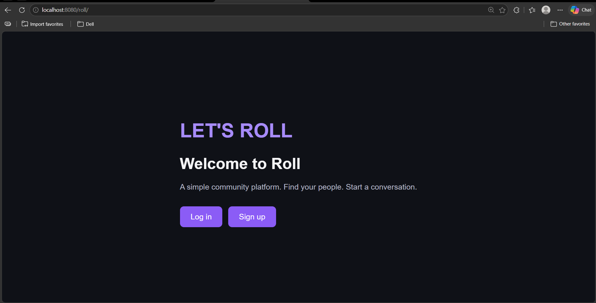
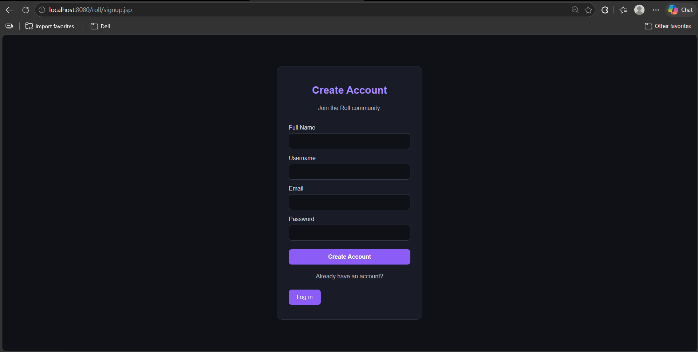
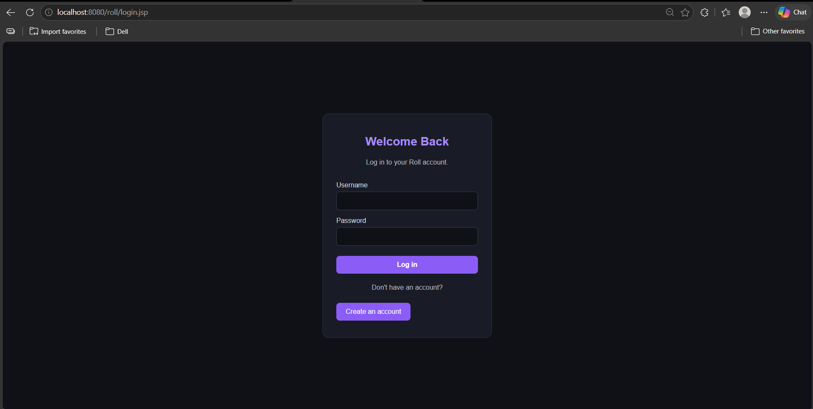
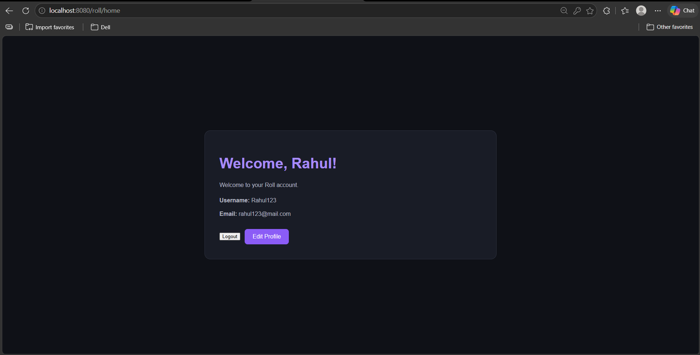
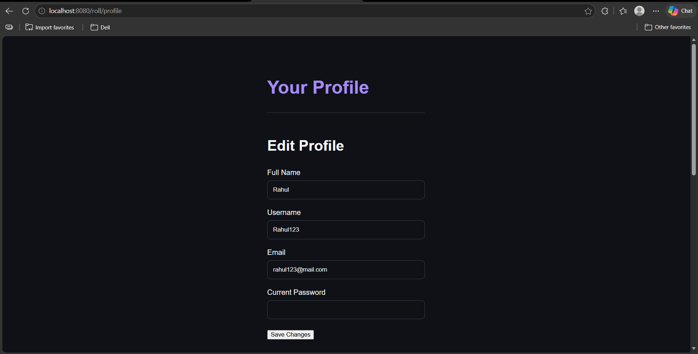
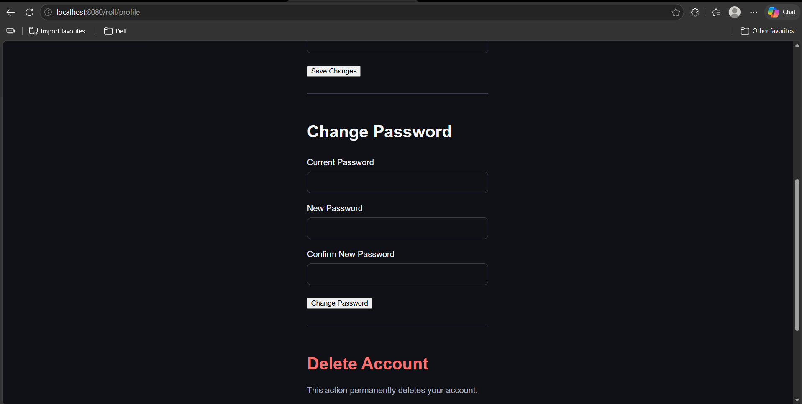
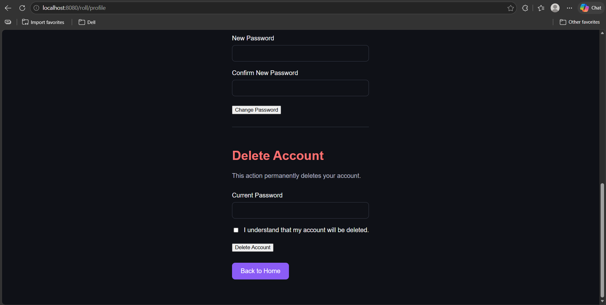

# Roll — Java Web Application


Roll is a user account management web application built with Java Servlets, JSP, JDBC, and MySQL. It provides user registration, login, session-based authentication, and account management functionality.

User input is validated, and passwords are securely stored as BCrypt hashes rather than plain text.

## Screenshots

<table>
  <tr>
    <td align="center"><b>Landing Page</b><br></td>
    <td align="center"><b>Sign Up</b><br></td>
  </tr>
  <tr>
    <td align="center"><b>Login</b><br></td>
    <td align="center"><b>Home</b><br></td>
  </tr>
  <tr>
    <td align="center"><b>Edit Profile</b><br></td>
    <td align="center"><b>Change Password</b><br></td>
  </tr>
  <tr>
    <td align="center"><b>Delete Account</b><br></td>
    <td></td>
  </tr>
</table>

## Features

- User registration and login
- Session-based authentication
- Password hashing with BCrypt
- Input validation for usernames, names, email addresses, and passwords
- Profile management
- Password change functionality
- Account deletion
- MySQL database integration using JDBC
- Database credentials loaded from environment variables

## Tech Stack

| Layer | Technology |
|---|---|
| Programming Language | Java 21 |
| Web Technology | Jakarta Servlets, JSP |
| Database Connectivity | JDBC |
| Database | MySQL |
| Password Security | BCrypt |
| Build Tool | Apache Maven |
| Application Server | Apache Tomcat 10 |
| Testing | JUnit 5 |

## Architecture

Roll follows the Model-View-Controller (MVC) architectural pattern.

- **Model:** Represents application data and user information.
- **View:** JSP pages render the user interface.
- **Controller:** Servlets handle HTTP requests and application flow.
- **Data Access:** DAO classes manage database operations using JDBC.
- **Database Connection:** A dedicated `DatabaseConnection` class manages connections to MySQL.

### Authentication Flow

1. **Registration:** User details are validated, the password is hashed using BCrypt, and the resulting hash is stored in the database.
2. **Login:** The submitted password is checked against the stored BCrypt hash. Upon successful authentication, the user is associated with an HTTP session.
3. **Profile Management:** Authenticated users can update their profile information.
4. **Password Change:** Users can change their account password.
5. **Account Deletion:** Authenticated users can request deletion of their account.
6. **Logout:** The user's session is invalidated.

## Project Structure

```text
roll/
├── docs/
│   └── screenshots/
│       ├── index.png
│       ├── signup.png
│       ├── login.png
│       ├── home.png
│       ├── profileEdit.png
│       ├── changePassword.png
│       └── deleteAccount.png
├── src/
│   ├── main/
│   │   ├── java/com/roll/
│   │   │   ├── dao/
│   │   │   ├── database/
│   │   │   ├── model/
│   │   │   ├── servlet/
│   │   │   └── validation/
│   │   └── webapp/
│   │       ├── WEB-INF/
│   │       ├── css/
│   │       ├── index.jsp
│   │       ├── login.jsp
│   │       └── signup.jsp
│   └── test/
│       └── java/com/roll/
├── schema.sql
├── pom.xml
├── README.md
└── .gitignore
```

## Getting Started

### Prerequisites

Make sure you have the following installed:

- Java Development Kit (JDK) 21
- Apache Maven
- MySQL Server
- Apache Tomcat 10.1

### 1. Clone the Repository

```bash
git clone https://github.com/prollyrahul/roll.git
cd roll
```

### 2. Create the Database

Create the database in MySQL:

```sql
CREATE DATABASE roll;
```

Import the database schema from the project root:

```bash
mysql -u <your-username> -p roll < schema.sql
```

Replace `<your-username>` with your MySQL username. Enter your password when prompted.

### 3. Configure Environment Variables

The application reads its database configuration from environment variables.

| Variable | Description | Example |
|---|---|---|
| `DB_URL` | JDBC connection URL | `jdbc:mysql://localhost:3306/roll` |
| `DB_USER` | MySQL username | `your_username` |
| `DB_PASSWORD` | MySQL password | `your_password` |

Do not commit real database credentials to the repository.

#### Windows — Command Prompt

```bat
set DB_URL=jdbc:mysql://localhost:3306/roll
set DB_USER=your_username
set DB_PASSWORD=your_password
```

These variables apply only to the current Command Prompt session and processes started from it.

#### macOS / Linux

```bash
export DB_URL="jdbc:mysql://localhost:3306/roll"
export DB_USER="your_username"
export DB_PASSWORD="your_password"
```

Start Tomcat in an environment where these variables are available. If Tomcat runs as a Windows service, configure the environment for that service separately.

### 4. Build the Application

From the project root, run:

```bash
mvn clean package
```

Maven compiles the application, runs the configured tests, and packages the application as a WAR file in the `target/` directory.

### 5. Deploy to Tomcat

1. Copy the generated `roll.war` file from `target/` into Tomcat's `webapps/` directory.
2. Start Tomcat with the required database environment variables available.
3. Open the application in your browser:

```text
http://localhost:8080/roll/
```

The context path depends on the deployed WAR filename.

## Running Tests

Run the complete test suite with:

```bash
mvn test
```

To run the database connection test specifically:

```bash
mvn -Dtest=DatabaseConnectionTest test
```

The database connection test requires a running MySQL server, a configured `roll` database, and valid database environment variables.

## Security Considerations

- Passwords are stored as BCrypt hashes rather than plain text.
- User input is validated before processing.
- Database credentials are loaded from environment variables.
- Session-based authentication protects account-related functionality.
- Logout invalidates the user's HTTP session.

For a separate project exploring password hashing and why plain SHA-256 is not suitable for password storage, see [java-password-hashing](https://github.com/prollyrahul/java-password-hashing).

## Future Improvements

- Expand automated tests for authentication and profile management.
- Add CSRF protection to form submissions.
- Introduce login attempt rate limiting.
- Implement password reset through email.
- Expose selected functionality through a REST API.
- Explore migrating the application to Spring Boot.

## Project Status

Roll is a personal learning project focused on Java web development, MVC architecture, database integration, authentication, and account management.

## Author

**Rahul Kumar**

- GitHub: [prollyrahul](https://github.com/prollyrahul)
- LinkedIn: [prollyrahul](https://www.linkedin.com/in/prollyrahul)